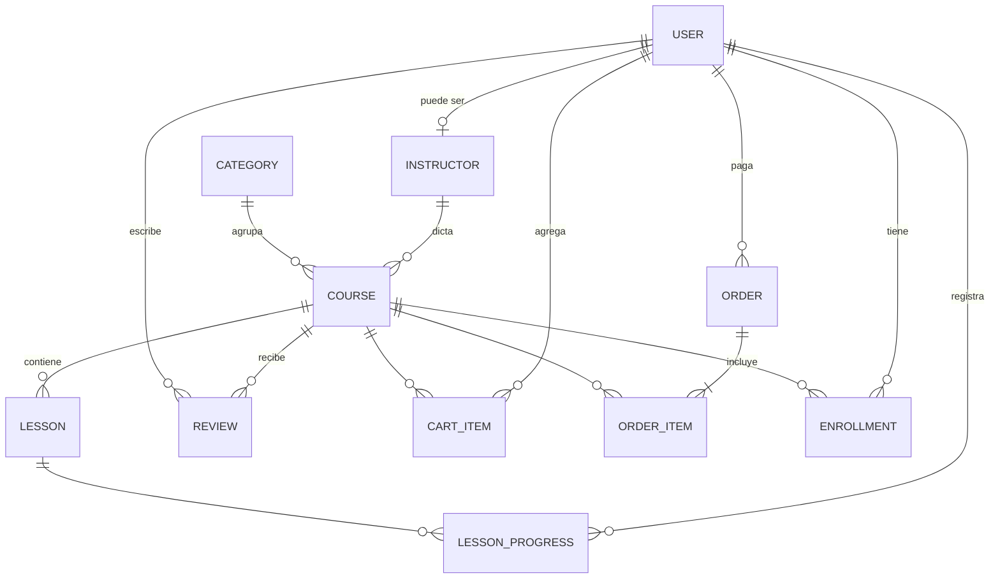

# SportAcademy

Marketplace PWA de cursos deportivos. Hoy es un MVP 100 % frontend: los datos viven en `src/data/courses.ts` y el estado del usuario en `localStorage`. La sección [Backend](#backend-entidades-necesarias) describe lo que necesita una API real para reemplazar esos mocks.

## Requisitos

- Node.js 18 o superior
- npm

## Instalación y uso

```bash
npm install
npm run dev
```

| Comando           | Descripción                                      |
| ----------------- | ------------------------------------------------ |
| `npm run dev`     | Levanta el servidor de desarrollo de Vite.       |
| `npm run build`   | Compila TypeScript y genera el build en `dist/`. |
| `npm run preview` | Sirve localmente el build de producción.         |

Para formatear el código con la configuración del proyecto (`.prettierrc`):

```bash
npx prettier --write .
```

## Estructura

```text
src/
├── main.tsx              # punto de entrada: monta <App />
├── App.tsx               # rutas, layout y carga diferida (lazy) de páginas
├── index.css             # estilos base de Tailwind
├── components/
│   ├── Header.tsx        # navegación, buscador, menú móvil e instalación PWA
│   ├── Footer.tsx
│   ├── Layout.tsx        # Header + <Outlet /> + Footer
│   ├── CourseCard.tsx    # tarjeta de curso con botón de carrito
│   ├── Skeleton.tsx      # Skeleton y GridSkeleton
│   └── Empty.tsx         # estado vacío reutilizable
├── pages/
│   ├── Home.tsx          # /
│   ├── Catalog.tsx       # /courses?q=&sport=
│   ├── Detail.tsx        # /course/:slug
│   ├── Cart.tsx          # /cart
│   ├── MyLearning.tsx    # /my-learning
│   ├── Login.tsx         # /login (React Hook Form + Zod)
│   └── Learn.tsx         # /learn/:courseId/:lessonId
├── hooks/
│   └── useTitle.ts       # título del documento por página
├── data/courses.ts       # mocks: 15 cursos, categorías, instructores y reseñas
├── lib/utils.ts          # cn, simulateNetworkDelay, formatPrice
├── store/useStore.ts     # estado global con Zustand (persistido)
└── types/index.ts        # modelos de datos
public/
└── offline.html          # página de respaldo sin conexión
```

Convenciones: los componentes usan exportaciones nombradas y las páginas exportaciones por defecto, para que `React.lazy` las cargue en chunks separados.

## Arquitectura

- **React 18 + Vite + TypeScript** en modo estricto; el alias `@/` apunta a `src/`.
- **React Router v6** separa el layout principal del reproductor de aprendizaje, y cada página se carga bajo demanda con `Suspense`.
- **Tailwind CSS** con diseño mobile-first y modo oscuro mediante una clase en la raíz.
- **Zustand** persiste en `localStorage` (clave `sportacademy-store`) el carrito, los cursos inscritos, el avance y la sesión demo.
- **React Hook Form + Zod** validan el formulario de inicio de sesión simulado.
- La latencia de red se simula con `simulateNetworkDelay` (800-1500 ms), mostrando skeletons de altura estable para minimizar el CLS.

## PWA

`vite-plugin-pwa` genera el manifest y el service worker:

- Los recursos del build se precachean.
- Las navegaciones usan `NetworkFirst` (timeout de 3 s): una ruta visitada abre sin conexión desde la caché y una no visitada muestra `public/offline.html`.
- Las imágenes de Picsum usan una caché en tiempo de ejecución limitada.
- Los videos (`.mp4`, `.webm`) nunca se precachean ni entran en la caché de ejecución, para proteger la cuota del navegador.

## Decisiones de producto

- El checkout, el login y el progreso son simulaciones locales: no hay backend ni cobros reales.
- Los videos usan un MP4 público estable y las imágenes usan semillas fijas de Picsum.
- El catálogo permite buscar, filtrar por deporte, nivel y rango de precio, y ordenar por popularidad, valoración y precio.

## Backend: entidades necesarias

Para que este front funcione con datos reales, el back necesita las entidades de abajo. Los nombres siguen los tipos de `src/types/index.ts` para que el cambio en el front sea mínimo.



### Catálogo

**User**: `id`, `email` (único), `name`, `passwordHash`, `avatar?`, `role` (`student` | `instructor` | `admin`), `createdAt`. Hoy el store guarda solo `{ name, email }`.

**Instructor**: `id`, `userId`, `name`, `avatar`, `bio`. Los campos `rating`, `students` y `coursesCount` que muestra el detalle del curso son agregados: se calculan desde sus cursos, reseñas e inscripciones (o se guardan desnormalizados y se actualizan con cada evento).

**Category** (deporte): `id`, `name`, `slug` (único), `icon`. `coursesCount` es un agregado. Reemplaza al tipo `Sport`, que hoy es una unión fija de 12 valores; el curso pasa a tener `categoryId`, y la API puede seguir devolviendo `sport` con el nombre.

**Course**: `id`, `slug` (único, lo usa `/course/:slug`), `title`, `subtitle`, `description`, `categoryId`, `instructorId`, `level` (`Principiante` | `Intermedio` | `Avanzado`), `price` (guardar en centavos y una `currency`, hoy USD), `thumbnail`, `previewVideo`, `tags[]`, `status` (`draft` | `published`), `createdAt`, `updatedAt` (fecha real; el front la formatea). Agregados: `rating`, `reviewsCount`, `students` y `duration`.

**Lesson**: `id`, `courseId`, `position` (orden en el temario), `title`, `durationSeconds` (el front hoy recibe `"7:20"`), `videoUrl`, `isFree` (vista previa sin inscripción). El campo `completed` del tipo actual no pertenece a la lección: es progreso por usuario y va en `LessonProgress`. Si el temario crece, se puede agregar una entidad `Section` entre curso y lección.

**Review**: `id`, `courseId`, `userId`, `rating` (1-5), `comment`, `createdAt`. Restricción única `(courseId, userId)` y solo para usuarios inscritos. La API devuelve `user` y `avatar` desde el usuario. Hoy las 3 reseñas son las mismas para todos los cursos.

### Usuario

**CartItem**: `userId`, `courseId`, `addedAt`, con clave `(userId, courseId)`. Reemplaza `cart: string[]`. Para invitados se puede mantener el carrito local y fusionarlo al iniciar sesión.

**Order**: `id`, `userId`, `status` (`pending` | `paid` | `failed` | `refunded`), `total`, `currency`, `paymentProvider`, `paymentRef`, `createdAt`. **OrderItem**: `orderId`, `courseId`, `price` (precio al momento de compra). Hoy `enroll()` inscribe directo sin pago.

**Enrollment**: `userId`, `courseId`, `orderId?`, `enrolledAt`, con clave `(userId, courseId)`. Reemplaza `enrolled: string[]`. Se crea cuando la orden pasa a `paid`, nunca desde el cliente.

**LessonProgress**: `userId`, `lessonId`, `courseId`, `completedAt`, con clave `(userId, lessonId)`. Reemplaza `completed: Record<courseId, lessonId[]>`. El porcentaje de Mi aprendizaje es `completadas / total de lecciones`.

### Endpoints que consume cada pantalla

| Método | Ruta                                      | Pantalla / acción del store                                                                                        |
| ------ | ----------------------------------------- | ------------------------------------------------------------------------------------------------------------------ |
| `POST` | `/auth/register`, `/auth/login`           | Login (`login`)                                                                                                    |
| `POST` | `/auth/logout`, `GET /auth/me`            | Header (`logout`, `user`)                                                                                          |
| `GET`  | `/categories`                             | Home y filtros del catálogo                                                                                        |
| `GET`  | `/courses?q=&sport=&level=&price=&sort=`  | Home (destacados) y Catálogo; `sort` = `popular`, `rating`, `low`, `high`; `price` = `under35`, `35to45`, `over45` |
| `GET`  | `/courses/:slug`                          | Detalle: curso, instructor y temario                                                                               |
| `GET`  | `/courses/:id/reviews`                    | Pestaña de reseñas                                                                                                 |
| `POST` | `/courses/:id/reviews`                    | Dejar reseña (solo inscritos)                                                                                      |
| `GET`  | `/me/cart`                                | Carrito y contador del Header                                                                                      |
| `POST` | `/me/cart` · `DELETE /me/cart/:courseId`  | `addToCart` · `removeFromCart`                                                                                     |
| `POST` | `/checkout`                               | Cart (`enroll`): crea la orden y redirige al pago                                                                  |
| `POST` | `/webhooks/payments`                      | Confirma el pago y crea las inscripciones                                                                          |
| `GET`  | `/me/enrollments`                         | Mi aprendizaje, con el progreso de cada curso                                                                      |
| `GET`  | `/me/courses/:courseId/lessons/:lessonId` | Learn: devuelve la URL del video (firmada) si está inscrito o `isFree`                                             |
| `PUT`  | `/me/progress/:lessonId` · `DELETE`       | `toggleLesson`                                                                                                     |

### Notas para la integración

- **Autenticación**: JWT de acceso corto con refresh token en cookie `httpOnly`. Las rutas `/me/*` y `/checkout` la requieren.
- **Videos**: hoy cualquiera ve cualquier lección. El back debe validar la inscripción y entregar URLs firmadas con expiración (S3/CloudFront, Mux, Bunny, etc.). Se mantiene la regla del service worker de no cachear videos.
- **Búsqueda y orden**: el front hoy filtra en memoria; con datos reales conviene paginar (`page`, `limit`) y filtrar en la base de datos (índices en `slug`, `categoryId`, `level`, `price` y texto completo en `title` y `tags`).
- **Agregados**: `rating`, `reviewsCount`, `students` y `duration` se recalculan al crear una reseña, una inscripción o una lección, para no calcularlos en cada lectura.
- **Migración del front**: reemplazar las importaciones de `@/data/courses` por llamadas a la API (por ejemplo con TanStack Query) y `simulateNetworkDelay` por la latencia real. El store de Zustand queda solo para el estado de la UI y un caché del usuario.
